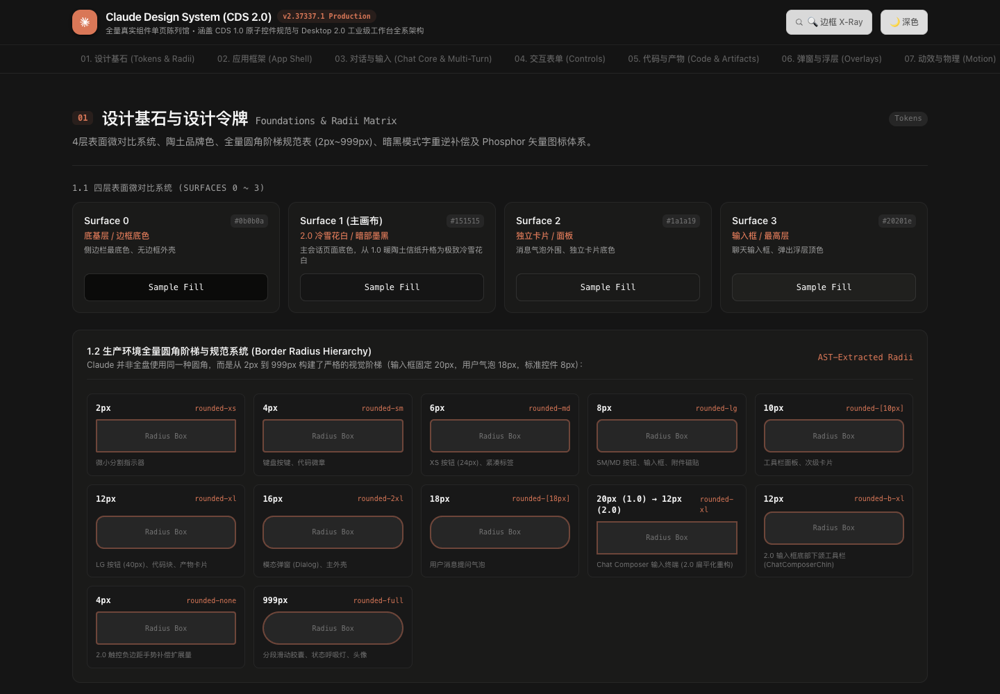

# Claude Design

[](https://github.com/asaki9385/claude-design/actions/workflows/verify.yml)
[](LICENSE)

把 Claude Design System（CDS）打包成一套可直接安装、可阅读、可验证的 Agent Skill。

仓库收录 33 个可拷贝的 React/TS 设计系统模块、完整语义令牌、四档弹簧物理参数、硬性验收清单、v1/v2 共 10,094 行逆向文档，以及完整的上游源码快照和无需网络的组件故事书。它不是 Anthropic 官方 SDK，而是一套社区 clean-room 逆向实现的工程化整理。



## 包含什么

| 内容 | 规模 | 用途 |
| :-- | :-- | :-- |
| React/TS 源码 | 33 个模块 | 按钮、分段控件、消息流、Composer、弹窗、Artifacts 分栏、代码块、多代理画布等 |
| 设计令牌 | 4 层 surface + semantic tokens | 用低对比表面阶梯、发丝边框和陶土色建立 CDS 视觉层级 |
| 动效规范 | 4 档 spring + 10 组 easing | 统一入场、展开、拖拽、吸附和按压反馈 |
| 工程参考 | tokens / components / motion / invariants | 便于 Agent 先查规格，再复制源码 |
| 完整上游快照 | 71 个文件，1.2 MB | 保留 README、src、code-examples、assets、package 配置和原始目录关系 |
| v1 逆向手册 | 8 篇 + 合并版，8442 行 | 解释数值来源、组件组合和系统级交互 |
| v2 逆向报告 | 6 章 + 合并版，1652 行 | Desktop 2.0 多窗口、算力档位、离线队列和 CSS 合成器动效 |
| 离线故事书 | 377 KB 单文件 HTML | 9 个章节的完整组件陈列馆，双击即开，无 CDN 或字体文件 |
| 冒烟示例 | 352 KB 单文件 HTML | 对按钮、分段控件和思考折叠做自动交互断言 |

完整内容位于 [`plugins/claude-design/skills/claude-design/`](plugins/claude-design/skills/claude-design/)。

目录关系：

```text
plugins/claude-design/skills/claude-design/
├── SKILL.md
├── references/
│   ├── design-tokens.md, components.md, motion.md, invariants.md
│   └── upstream/          # 71 个文件，完整保留 Caho1/open-claude-ui 源库
│       ├── docs/v1/
│       ├── docs/v2/
│       ├── code-examples/
│       ├── src/
│       └── assets/
├── assets/
│   ├── claude-components-storybook.html
│   └── cds-offline-demo.html
└── scripts/
```

## 安装

### Claude Code 插件市场

```text
/plugin marketplace add asaki9385/claude-design
/plugin install claude-design@claude-design
```

安装后重启会话，让插件重新扫描。

### 直接加载插件

```bash
git clone https://github.com/asaki9385/claude-design.git
cd claude-design
claude --plugin-dir ./plugins/claude-design
```

### 只安装 Skill

Claude Code：

```bash
git clone https://github.com/asaki9385/claude-design.git
mkdir -p ~/.claude/skills
cp -R claude-design/plugins/claude-design/skills/claude-design ~/.claude/skills/
```

Codex：

```bash
git clone https://github.com/asaki9385/claude-design.git
mkdir -p ~/.codex/skills
cp -R claude-design/plugins/claude-design/skills/claude-design ~/.codex/skills/
```

也可以复制到项目内的 `.claude/skills/` 或 `.agents/skills/`。务必复制整个技能目录，保留 `references/`、`scripts/` 和 `assets/`。

## 使用

安装后直接描述要做的界面，例如：

```text
用 Claude 风格重做这个设置页。先读 CDS 令牌和组件规范，复用
SegmentedControl、CdsButton 和 ConfirmationDialog，不要自创一套近似样式。
```

Agent 会先读取 `design-tokens.md`、`components.md` 和相关源码，再按项目的 React/Tailwind 结构接入。适合的任务包括：

- 制作或改造 Claude 风格的聊天界面、Composer、消息气泡和思考折叠。
- 修正“颜色像但质感不像”的 CDS 实现，包括表面阶梯、边框、阴影和动效。
- 从 33 个模块中挑出可复用源码，接到现有 React 项目。
- 生成零外部请求的单文件 HTML 原型。

## 直接查看示例

打开以下任一文件即可查看交互；React、CSS 和图标全部内联，断网也能运行：

- [`claude-components-storybook.html`](plugins/claude-design/skills/claude-design/assets/claude-components-storybook.html)：完整 9 章故事书，支持主题切换、X-Ray 边框检测和 Desktop 2.0 实验室。
- [`cds-offline-demo.html`](plugins/claude-design/skills/claude-design/assets/cds-offline-demo.html)：体量更小的冒烟示例。

上游原始故事书依赖 Tailwind、React、Babel 和 Google Fonts CDN，原文件按原样保存在 [`references/upstream/docs/`](plugins/claude-design/skills/claude-design/references/upstream/docs/)；`assets/` 中是由 `npm run build:storybook` 重新打包的离线版本。

## 验证

要求 Node.js 20.19+。仓库测试覆盖三层：

```bash
npm ci
npm test
```

- `validate`：检查 market/plugin 清单、Skill frontmatter、33 个源码模块、关键参考文件、本地绝对路径泄漏和离线资源。
- `snapshot`：用 SHA-256 清单校验 71 个上游文件逐字节未缺失、未被意外改写。
- `build:storybook`：从上游原始故事书抽取 CSS/JSX，内联 React、ReactDOM 和 Tailwind。
- `test:demo`：用 jsdom 执行完整 bundle，点击按钮并断言 React 状态从 0 变为 1。
- `test:browser`：使用本机 Chrome、Chromium 或 Edge 验证两个资产、主题/X-Ray 交互和桌面/移动端布局。

本机有 Chrome 时，一次跑完全部检查：

```bash
npm run verify
```

CI 会执行 `npm ci`、`npm test` 和 `npm run test:browser`。当前测试不依赖 Anthropic API，也不需要网络代理或私有密钥。

## 更新来源

组件、故事书与手册完整 vendored 自 [Caho1/open-claude-ui](https://github.com/Caho1/open-claude-ui)，快照清单位于 [`references/upstream-manifest.json`](plugins/claude-design/skills/claude-design/references/upstream-manifest.json)。本仓库只调整插件市场布局、可移植路径、离线构建、测试和发布元数据，不改变组件设计与动效常数。

## 许可与声明

代码以 [MIT License](LICENSE) 发布，原始版权归 Caho1 所有。详见 [NOTICE.md](NOTICE.md)。

本项目与 Anthropic 无隶属或背书关系。“Claude”及相关品牌资产归 Anthropic 所有。仓库不包含 Anthropic 的字体、录音或其他专有二进制资产。用于商业产品前，请自行确认商标、品牌和逆向工程的合规边界。

